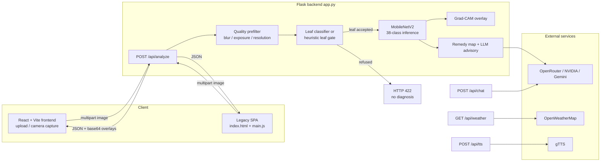

# KrishiVaaniAI: An AI-Based Plant Leaf Disease Detection and Classification System

[](https://www.python.org/downloads/release/python-3110/)
[](https://flask.palletsprojects.com/)
[](https://pytorch.org/)
[](https://react.dev/)
[](https://github.com/23se02cb064/KrishiVaaniAI_)

A web-based agricultural decision-support tool that classifies plant leaf diseases with a MobileNetV2 model, explains predictions with Grad-CAM attention overlays, and answers farmer questions through an LLM-backed chat assistant with weather context.

> **Prototype status.** The shipped model is an experimental baseline. On external field imagery (PlantDoc, never used in training) it measures **13.33% top-1 accuracy** at 54% mean confidence. It is a research prototype with a safety gate for non-leaf input — not a production-grade or scientifically validated diagnostic tool. See [Model Information](#model-information) and [Limitations](#limitations-and-future-improvements).

## Table of Contents

- [Project Overview](#project-overview)
- [Key Features](#key-features)
- [Technology Stack](#technology-stack)
- [System Architecture](#system-architecture)
- [Model Information](#model-information)
- [Project Structure](#project-structure)
- [Installation and Local Setup](#installation-and-local-setup)
- [Environment Variables](#environment-variables)
- [API Documentation](#api-documentation)
- [Model Training and Validation](#model-training-and-validation)
- [Testing](#testing)
- [Deployment](#deployment)
- [Limitations and Future Improvements](#limitations-and-future-improvements)
- [Privacy and Security](#privacy-and-security)
- [Contribution Guidelines](#contribution-guidelines)
- [License and Acknowledgments](#license-and-acknowledgments)
- [Contact and Project Information](#contact-and-project-information)

## Project Overview

Identifying crop diseases by eye is slow, error-prone, and inaccessible to farmers without agronomic training. KrishiVaaniAI (branded **CH AI** in the UI) is a web application that lets a user upload or photograph a plant leaf and receive, within seconds:

1. A predicted crop and disease class from a 38-class MobileNetV2 classifier.
2. A confidence score, top-3 alternatives, and an explicit "uncertain" flag when confidence is low.
3. A Grad-CAM heatmap highlighting the image regions that most influenced the prediction.
4. A practical field remedy, plus optional AI-generated advice in the user's language.

The application also provides an agricultural chat assistant, live weather via OpenWeatherMap, and text-to-speech output. The goal is decision support — a second opinion that helps a farmer decide whether to treat a plant or consult a local expert — not automated diagnosis.

## Key Features

### Implemented and verified in the source

- **Leaf disease classification** — MobileNetV2 (38 PlantVillage classes) served directly from the Flask backend; CPU-capable, CUDA used automatically when available (`app.py:39`).
- **Image upload and camera capture** — drag-and-drop/click upload in the React UI (`frontend/src/pages/Disease.jsx`) plus in-browser camera capture via `getUserMedia` with progressive constraint fallback (`frontend/src/components/CameraCapture.jsx`).
- **Prediction with confidence and top-3 classes** — every successful response carries `confidence`, `is_uncertain` (below the 0.5 threshold), and the top-3 class probabilities.
- **Grad-CAM visualization** — server-side Grad-CAM on the last MobileNetV2 convolutional layer, returned as base64 PNG overlay and heatmap; the React UI offers side-by-side, blend, and heatmap views (`gradcam.py`, `Disease.jsx`).
- **Leaf-suitability gate** — a dedicated MobileNetV3-small leaf/non-leaf classifier runs *before* the disease model and refuses non-leaf images (fail-closed); a heuristic vegetation/detail gate is the fallback, and a quality prefilter rejects blurry, underexposed, oversaturated, or blank images. Refused uploads return HTTP 422 with a machine-readable `error_type` and **no** diagnosis (`leaf_classifier.py`, `leaf_gate.py`, `app.py`).
- **AI agricultural chatbot** — `/api/chat` answers crop, disease, pest, weather, and storage questions through a provider chain (NVIDIA → OpenRouter → Gemini) with an 8-second wall-clock budget and a local offline fallback (`app.py:1924`).
- **Weather information** — `/api/weather` via OpenWeatherMap by city name or lat/lon coordinates, with geolocation support in the legacy UI.
- **Text-to-speech** — `/api/tts` converts advice to audio via gTTS and returns base64 audio; the legacy UI additionally uses the browser `speechSynthesis` API when voices are available.
- **Multilingual support** — the legacy single-page UI (`index.html` + `main.js`) is translated into 13 languages (Assamese, Bengali, English, Gujarati, Hindi, Kannada, Malayalam, Marathi, Odia, Punjabi, Tamil, Telugu, Urdu) and supports Web Speech API voice input. **The React frontend currently sends `lang: "en"` only**; its pages are English-only.
- **Prediction history and analytics** — successful predictions are persisted to SQLite (SQLAlchemy) and exposed through `/api/predictions`, CSV export, and a per-day activity series consumed by the Dashboard.
- **In-app training dashboard** — `POST /api/training/start` runs the training pipeline in a background thread; the React Training page polls `/api/training/status` and plots loss/accuracy charts.
- **Progressive Web App** — `manifest.json` and `sw.js` provide app-shell caching, offline navigation, an IndexedDB offline request queue, and background sync for the legacy UI.
- **Responsive frontend/backend integration** — React 18 + Vite + Tailwind CSS frontend with a Vite dev proxy (`/api` → `localhost:5000`); the Flask backend also serves the production build from `frontend/dist/`.
- **Safety and reliability** — model checkpoint SHA-256 is verified at startup (the server refuses to start on mismatch), uploads are validated by extension, MIME type, magic bytes, and a 16 MB size limit, and endpoints are rate-limited with `flask-limiter`.

### Experimental / planned (not yet implemented)

- Satellite NDVI, rainfall forecasts, SMS/WhatsApp connectors, farmer community Q&A, and market-price data are **not implemented** in the current codebase.
- Confidence temperature-scaling calibration is implemented in code but **disabled by default** (`CALIBRATION_FILE` unset).
- User registration/login endpoints exist, but the React UI does not use them yet.

## Technology Stack

| Layer | Technology |
|---|---|
| Backend | Python 3.11, Flask 3.1.1, flask-cors, flask-limiter, Werkzeug, gunicorn |
| ML / Vision | PyTorch 2.0.1, torchvision 0.15.2 (MobileNetV2, MobileNetV3-small), Pillow, NumPy |
| AI services | OpenAI-compatible clients for NVIDIA and OpenRouter, Google GenAI (Gemini), gTTS |
| Storage | SQLAlchemy 2.x + SQLite (prediction history, user scaffolding), PyJWT (auth tokens) |
| Primary frontend | React 18.2, Vite 5, Tailwind CSS 3.4, JavaScript (JSX) |
| Legacy frontend | HTML5, CSS3, vanilla JavaScript, Tailwind CDN, Web Speech API |
| APIs | OpenWeatherMap (weather), OpenRouter / NVIDIA / Gemini (advisory LLM) |
| Hosting | Render (backend + built frontend), Netlify or Vercel (static legacy UI) |

## System Architecture

The React frontend (or the legacy single-page UI) talks to the Flask backend over REST. Images are uploaded as `multipart/form-data`, validated, passed through the leaf-suitability gate, classified by MobileNetV2, and optionally explained with Grad-CAM. Predictions, remedies, and base64 Grad-CAM images are returned as JSON.



Successful predictions are written to a local SQLite database (`data.db`, configurable via `DATABASE_URL`) and surfaced through the history, export, and analytics endpoints.

## Model Information

| Property | Value |
|---|---|
| Architecture | `torchvision.models.mobilenet_v2(weights=None)` — trained from scratch, **not** ImageNet-pretrained |
| Classifier head | `nn.Linear(1280, 38)` |
| Input | 224×224 RGB, ImageNet mean/std normalization, `Resize(256) + CenterCrop(224)` |
| Classes | 38 (see table below) |
| Checkpoint | `mobilenetv2_leaf_disease_final.pth` (8.9 MB) |
| Checkpoint SHA-256 | `9A6B3EB1F3D48FB34831E13C840A6D09E481A6D758807390661DF74BC5FB850` (verified at startup) |
| Class mapping | `index_to_name.json` |
| Grad-CAM target | Last `Conv2d` in `model.features`, found dynamically (`gradcam.py`) |
| Intended use | Agricultural decision support only — **not** production-grade, not clinically/scientifically validated |

**The 38 supported classes** (14 crops):

| Crop | Classes |
|---|---|
| Apple (4) | Apple scab, Black rot, Cedar apple rust, Healthy |
| Blueberry (1) | Healthy |
| Cherry (2) | Powdery mildew, Healthy |
| Corn (4) | Cercospora leaf spot / Gray leaf spot, Common rust, Northern Leaf Blight, Healthy |
| Grape (4) | Black rot, Esca (Black Measles), Leaf blight (Isariopsis Leaf Spot), Healthy |
| Orange (1) | Haunglongbing (Citrus greening) |
| Peach (2) | Bacterial spot, Healthy |
| Pepper (2) | Bacterial spot, Healthy |
| Potato (3) | Early blight, Late blight, Healthy |
| Raspberry (1) | Healthy |
| Soybean (1) | Healthy |
| Squash (1) | Powdery mildew |
| Strawberry (2) | Leaf scorch, Healthy |
| Tomato (10) | Bacterial spot, Early blight, Late blight, Leaf Mold, Septoria leaf spot, Spider mites (Two-spotted), Target Spot, Yellow Leaf Curl Virus, Mosaic virus, Healthy |

**Measured external accuracy is low.** On a frozen 60-image external set the model scores 13.33% top-1 / 33.33% top-3 at 54.05% mean confidence; on the expanded 153-image PlantDoc test split it scores 13.07% top-1 / 24.84% top-3 at 58.89% mean confidence (details in [Model Training and Validation](#model-training-and-validation)). Confidence is poorly calibrated (Expected Calibration Error ≈ 0.41–0.46): wrong predictions are often made confidently, which is exactly why the leaf gate and uncertainty flag exist.

**Checkpoint hygiene.** `model_files/` and `notebooks/` contain duplicate files named `mobilenetv2_leaf_disease_final.pth` with **different** hashes (the `model_files/` copy measured 2/60 on the external set). `app.py` pins the audited root checkpoint by SHA-256 and refuses to start if a different checkpoint is found first. Do not overwrite the root checkpoint.

## Project Structure

Git-tracked files (run `git ls-files` to reproduce):

```
KrishiVaaniAI_/
├── app.py                          # Flask backend: routes, gates, inference, remedies
├── gradcam.py                      # Grad-CAM overlay/heatmap generation
├── leaf_classifier.py              # Primary leaf/non-leaf classifier (fail-closed)
├── leaf_gate.py                    # Heuristic leaf-suitability gate (fallback)
├── index_to_name.json              # 38-class index → name mapping
├── mobilenetv2_leaf_disease_final.pth  # Audited production checkpoint (SHA-256 pinned)
├── index.html                      # Legacy single-page UI (13-language, voice I/O)
├── main.js                         # Legacy UI logic: i18n, speech, API calls, PWA
├── sw.js                           # Service worker: offline cache, background sync
├── manifest.json                   # PWA manifest
├── torchserve_handler.py           # Legacy TorchServe handler (unused)
├── split_train_val.py              # Dataset train/val splitter utility
├── test_upload.py                  # Manual API smoke-test script
├── cleanup.bat                     # Windows cleanup helper
├── requirements.txt                # Backend dependencies
├── requirements-deploy.txt         # Render deployment dependencies
├── render.yaml                     # Render service definition
├── netlify.toml                    # Netlify hosting + API proxy rules
├── vercel.json                     # Vercel hosting + serverless proxy routes
├── api/proxy.js                    # Vercel serverless /api proxy
├── .env.example                    # Environment variable template
├── .python-version                 # Python 3.11
├── artifacts/
│   ├── leaf_classifier/            # Leaf/non-leaf checkpoint + config (thresholds, metrics)
│   └── leaf_gate/                  # Gate config + leaf prototypes
├── model_files/                    # Duplicate checkpoint (NOT the audited one — see above)
├── notebooks/                      # Training notebook + README
├── static/                         # PWA icons and image assets
├── frontend/                       # React 18 + Vite + Tailwind application
│   ├── src/
│   │   ├── App.jsx                 # App shell with light/dark theme
│   │   ├── main.jsx, index.css, api.js
│   │   ├── components/
│   │   │   ├── CameraCapture.jsx   # getUserMedia capture with fallback constraints
│   │   │   ├── Navbar.jsx, Sidebar.jsx
│   │   └── pages/
│   │       ├── Home.jsx            # Dashboard: recent predictions + activity
│   │       ├── Disease.jsx         # Upload/camera, results, Grad-CAM views
│   │       ├── Chat.jsx            # AI agricultural assistant
│   │       └── Training.jsx        # Training status + metric charts
│   ├── index.html, package.json, vite.config.js
│   └── tailwind.config.cjs, postcss.config.cjs
└── tests/                          # pytest suite (8 tracked files; see Testing)
```

Working-tree files **not currently committed to Git** (present in the development checkout): `train.py` (training pipeline, required by `POST /api/training/start`), `class_names.py` (class-name parsing), and the `docs/`, `validation/`, `experiments/`, and `audit/` folders with measurement reports. `data/`, `PlantDoc-Dataset*`, virtual environments, caches, and `*.db` files are gitignored.

## Installation and Local Setup

Prerequisites: Python 3.11, Node.js 18+, and (optionally) an NVIDIA GPU.

### 1. Clone the repository

```powershell
git clone https://github.com/23se02cb064/KrishiVaaniAI_.git
cd KrishiVaaniAI_
```

### 2. Create and activate a Python virtual environment

```powershell
python -m venv venv
venv\Scripts\Activate.ps1        # Windows PowerShell
# venv\Scripts\activate.bat      # Windows CMD
# source venv/bin/activate       # macOS / Linux
```

### 3. Install backend dependencies

```powershell
pip install -r requirements.txt
```

### 4. Configure environment variables

```powershell
Copy-Item .env.example .env      # Windows PowerShell
# cp .env.example .env           # macOS / Linux
```

Then edit `.env` and add your API keys (see [Environment Variables](#environment-variables)). The app starts without any keys — LLM advice, chat, and weather simply return graceful fallbacks.

### 5. Start the Flask backend

```powershell
python app.py
```

The API serves on `http://127.0.0.1:5000` (override with `PORT`). Health check: `http://127.0.0.1:5000/health`.

### 6. Start the React/Vite frontend (primary UI)

```powershell
cd frontend
npm install
npm run dev
```

The dev server runs on `http://localhost:5173` and proxies `/api` requests to `http://localhost:5000` (configured in `frontend/vite.config.js`).

For a production build, run `npm run build` in `frontend/`; the Flask backend then serves the built app from `frontend/dist/` at `/`.

### Legacy single-page UI

The legacy UI (`index.html`, `main.js`, 13-language translations, voice I/O, PWA) is served by the same Flask server from the repository root. When `frontend/dist/` exists, `/` serves the React app; the legacy files remain directly accessible (e.g. `/main.js`, `/manifest.json`, `/sw.js`).

## Environment Variables

Values from `.env.example`; placeholders only — never commit real keys.

| Variable | Required | Default | Purpose |
|---|---|---|---|
| `OPENROUTER_API_KEY` | Optional | — | OpenRouter API key for chat and advisory generation |
| `OPENROUTER_MODEL` | Optional | `openai/gpt-4.1-mini` | OpenRouter model identifier |
| `OPENWEATHER_API_KEY` | Optional | — | OpenWeatherMap key for `/api/weather` and chat weather context |
| `GEMINI_API_KEY` | Optional | — | Google Gemini key (third provider in the fallback chain) |
| `NVIDIA_API_KEY` | Optional | — | NVIDIA NIM key (first provider in the fallback chain) |
| `NVIDIA_MODEL` | Optional | `meta/llama-3.3-70b-instruct` | NVIDIA model identifier |
| `PORT` | Optional | `5000` | Flask listen port |
| `FLASK_DEBUG` | Optional | `False` | Flask debug mode |
| `ALLOWED_ORIGINS` | Optional | `http://localhost:5000,https://ch-ai.netlify.app` | CORS allowlist (comma-separated) |
| `RENDER_BACKEND_URL` | Optional | — | Backend URL used by the Vercel serverless proxy (`api/proxy.js`) |

Additional variables read by the code (not listed in `.env.example`):

| Variable | Default | Purpose |
|---|---|---|
| `ADVISORY_LLM_BUDGET_S` | `8` | Wall-clock budget (seconds) for the whole LLM fallback chain per request |
| `CONFIDENCE_THRESHOLD` | `0.5` | Predictions below this are flagged `is_uncertain` |
| `ANALYZE_TIMEOUT_SECONDS` | `30` | Per-request analysis timeout |
| `GRADCAM_TIMEOUT_SECONDS` | `10` | Grad-CAM generation timeout |
| `LEAF_CLASSIFIER_ENABLED` | `1` | Enable the dedicated leaf/non-leaf classifier |
| `LEAF_GATE_ENABLED` | `1` | Enable the heuristic gate fallback |
| `LEAF_VALIDATION_BYPASS` | `0` | **Keep at `0`** — bypasses the leaf gate (test-only) |
| `DISABLE_ADVISORY_LLM` | `0` | Set `1` to keep `/api/analyze` fully local |
| `CALIBRATION_FILE` | — | Path to a `temperature_*.json` to enable confidence calibration |
| `DATABASE_URL` | `sqlite:///data.db` | SQLAlchemy connection string |
| `JWT_SECRET` | hardcoded test value | **Override in deployment** — signs auth tokens |
| `AUDITED_MODEL_SHA256` | pinned hash | Must match the approved production checkpoint |

## API Documentation

All endpoints are implemented in `app.py`. Rate limits: default 1000/day + 200/hour; `/api/analyze` 10/min, `/api/analyze-batch` 5/min, `/api/tts` 20/min, `/api/chat` 10/min.

### Vision

| Method | Endpoint | Input | Response |
|---|---|---|---|
| `POST` | `/api/analyze` | `multipart/form-data`: `image` (file, required), `lang`, `include_gradcam` (`true`/`false`), `source` (`upload`/`camera`) | `200`: `{class, confidence, is_uncertain, confidence_threshold, remedy, remedy_source, lang, top_k_classes, timings, leaf_gate, gradcam_overlay, gradcam_heatmap}` · `422`: leaf gate refusal `{error, error_type, leaf_gate, lang}` (no diagnosis) · `400`: invalid/missing file · `504`: timeout |
| `POST` | `/api/analyze-batch` | `multipart/form-data`: `images[]` (multiple files), `lang` | `200`: `{results: [{filename, ...analyze result}]}` |
| `GET` | `/api/leaf-gate/status` | — | Gate configuration, thresholds, weights, prototype count, model SHA-256 match status |

A successful `/api/analyze` response contains: the predicted `class` (e.g. `Tomato___Early_blight`), `confidence` (0–1), `is_uncertain`, the `confidence_threshold`, a `remedy` plus its `remedy_source` (`static`, `llm`, or `unavailable`), the top-3 predictions with per-class confidence, per-stage `timings`, the gate summary, and — when `include_gradcam=true` — `gradcam_overlay` (original + heatmap blend) and `gradcam_heatmap` as base64 PNGs.

### Chat, weather, speech

| Method | Endpoint | Input | Response |
|---|---|---|---|
| `POST` | `/api/chat` | JSON: `{query (≤2000 chars), lang, lat, lon}` | `{reply, provider}` — provider is `cloud` or `offline-fallback` |
| `GET` | `/api/weather` | Query: `city` **or** `lat` + `lon` (defaults to Delhi) | `{weather: "Description, 27.3°C in City."}` |
| `POST` | `/api/tts` | JSON: `{text (≤500 chars), lang}` | `{audio: "<base64 MP3>"}` |

### Training, history, analytics, ops

| Method | Endpoint | Input | Response |
|---|---|---|---|
| `GET` | `/api/training/status` | — | `{status, epoch, total_epochs, metrics, updated_at}` |
| `POST` | `/api/training/start` | — | `202` `{message, status}` (background thread); `409` if already running |
| `GET` | `/api/predictions` | Query: `limit` (1–50, default 10) | `{predictions: [{id, class_name, confidence, remedy, lang, created_at}]}` |
| `GET` | `/api/predictions/export` | — | `{download_url, columns, preview}` |
| `GET` | `/api/predictions/export.csv` | — | CSV file download (`prediction_history.csv`) |
| `GET` | `/api/predictions/analytics` | — | `{series: [{label: "YYYY-MM-DD", count}]}` |
| `POST` | `/api/auth/register` | JSON: `{username, password}` | `{token, user}` |
| `POST` | `/api/auth/login` | JSON: `{username, password}` | `{token, user}` |
| `GET` | `/health` | — | `{status: "ok", model_loaded: bool}` |
| `GET` | `/api/calibration` | — | Temperature-scaling calibration status |
| `GET` | `/api/performance` | — | Aggregated in-process inference metrics (reset on restart) |

## Model Training and Validation

### Training

The training pipeline lives in `train.py` (present in the development working tree; required by the in-app training trigger). It expects the PlantVillage dataset at `data/PlantVillage/` with either pre-split `train/` and `val/` folders or one folder per class. The dataset is gitignored and is not distributed with the repository; download it from the [PlantVillage dataset page on Mendeley Data](https://data.mendeley.com/datasets/tywbtsjrjv/1).

```powershell
python train.py
```

Training configuration (from `TRAINING_CONFIG` in `train.py`):

| Parameter | Value |
|---|---|
| Image size | 224×224 |
| Batch size | 32 |
| Learning rate | 1e-4 (Adam) |
| Loss | CrossEntropyLoss |
| Epochs | up to 15 |
| Early stopping | patience 3 (validation accuracy) |
| Scheduler | CosineAnnealingLR (T_max=10) |
| Validation split | 15% (when no pre-split folders exist) |
| Augmentation | random resized crop, horizontal flip, ±15° rotation, color jitter |
| Random seed | 42 |

Note: `train.py` additionally imports `tqdm` and `scikit-learn`, which are **not** pinned in `requirements.txt` — install them separately before training (`pip install tqdm scikit-learn`).

Training runs save timestamped checkpoints to `artifacts/training_runs/` and **never overwrite** the production checkpoint `mobilenetv2_leaf_disease_final.pth`. Progress is written to `training_status.json`, which the frontend polls. The same pipeline can be started from the UI via `POST /api/training/start` (background thread, poll `GET /api/training/status`).

### Validation — training results vs. external results

These are two different things, and the repository keeps them separate:

- **Training/validation metrics** are produced by `train.py` on the PlantVillage train/val split. No verified final training-run metrics are committed to the repository (`training_status.json` currently records an incomplete run), so this README makes no claim about training-set accuracy.
- **External validation** was measured on the PlantDoc dataset `test/` split, which was never used for training, by the project's own measurement code (reports in `docs/`, working tree). These are the only verified generalization numbers:

| External set | Images | Classes covered | Top-1 | Top-3 | Mean confidence | ECE |
|---|---|---|---|---|---|---|
| Frozen baseline (`validation/unseen`) | 60 | 20 | 13.33% | 33.33% | 54.05% | 0.4072 |
| Expanded PlantDoc set | 153 | 19 of 38 | 13.07% | 24.84% | 58.89% | 0.4582 |

External validation is **complete for the measured sets but limited**: a single external source, 19 of 38 classes exercised, and some PlantDoc→PlantVillage label mappings rest on naming conventions (documented in the validation report). The results show the model generalizes poorly to field imagery; treat every prediction as a tentative suggestion.

Measured inference latency (CPU, 8 torch threads, 20 external images): preprocessing ≈ 26 ms, inference ≈ 48 ms, Grad-CAM median ≈ 200 ms (mean ≈ 0.9 s, tail up to ≈ 5 s). Grad-CAM is the dominant cost of an explained request.

## Testing

The pytest suite lives in `tests/`: 8 tracked files covering model loading and checkpoint integrity, the 38-class mapping, Grad-CAM content, leaf-gate refusals, batch analysis, auth, and prediction history, plus `test_disease_model_regression.py` (present in the working tree, not yet committed), which pins the model SHA-256, the class mapping, and per-class prediction structure — 38 test cases in total.

```powershell
pip install pytest
python -m pytest tests/ -v
```

Executed during this documentation pass with Python 3.11.9 and pytest 9.1.1: **37 passed, 1 skipped** in 62 s. The skipped test requires the PlantVillage validation split (`data/PlantVillage/val`), which is gitignored; tests that need it skip automatically when it is absent. The full dependency set (including `google-genai`) is required to import `app.py`.

The ad-hoc `test_*.py` scripts in the repository root are development utilities, not part of the pytest suite.

## Deployment

### Render (backend + built frontend, primary target)

`render.yaml` defines the service (`krishivaani`, Python 3.11, `ap-south-1`, free plan, 1 instance):

1. Create a new Render **Web Service** from this repository and connect it to `render.yaml`.
2. Add the Render secrets `openrouter_api_key` and `openweather_api_key` (referenced by `render.yaml` as environment variables).
3. The build command installs Node.js 22.16.0, runs `npm ci` and `npm run build` in `frontend/`, installs the CPU PyTorch wheels, then `pip install -r requirements-deploy.txt`.
4. The start command is `gunicorn app:app --bind 0.0.0.0:$PORT --workers 1 --timeout 120`; the health check path is `/health`.

Constraints to be aware of: the free plan provides a single instance with shared CPU — the CPU-only PyTorch wheels and the 120-second gunicorn timeout mean Grad-CAM requests (whose tail latency can reach seconds) may occasionally be slow, and the advisory LLM budget (`ADVISORY_LLM_BUDGET_S`, default 8 s) bounds third-party API waits.

### Netlify / Vercel (static legacy UI only)

- **Netlify**: `netlify.toml` publishes the root as a static site and proxies `/api/*` to a backend URL. The proxy target is currently hardcoded to `https://krishivaani-backend.onrender.com` — update it to your own backend domain before deploying.
- **Vercel**: `vercel.json` builds `index.html` as a static site and routes `/api/*` to the serverless function `api/proxy.js`, which forwards to `RENDER_BACKEND_URL`.

No live deployment URL is verified as part of this repository; do not assume one is running.

## Limitations and Future Improvements

**Genuine limitations (based on code and measured evidence):**

- **Low external accuracy**: 13.33% / 13.07% top-1 on PlantDoc field imagery, with high confidence on wrong answers. The model is a baseline, not a reliable field diagnostic.
- **Miscalibration**: Expected Calibration Error ≈ 0.41–0.46; confidence alone cannot signal out-of-domain input.
- **Limited external evidence**: validation covers one external source and 19 of 38 classes; some external labels are inferred from folder names.
- **Gate trade-offs**: the heuristic gate admits only ~46% of real-world leaves at its safe threshold; the dedicated classifier recovers 85.6% real-world leaf recall with zero non-leaf false accepts, but ~14% of real-world leaves are still refused or uncertain.
- **Grad-CAM tail latency**: median ≈ 200 ms, but the mean is ≈ 0.9 s with a ≈ 5 s maximum.
- **Advisory chain**: chat and remedy generation depend on third-party LLM providers; when all fail (or the 8 s budget expires), a static offline lookup answers instead.
- **React frontend is English-only**; the 13-language UI and voice input/output exist only in the legacy single-page UI.
- **Auth is scaffolding**: register/login endpoints exist but the React UI does not use them; the default `JWT_SECRET` is a known test value.
- **`train.py` and the measurement docs are not committed**; a fresh clone cannot run training or read the validation reports until they are added.

**Future work (planned, not implemented):** expanded multi-source external validation, confidence calibration enabled by default, a purpose-built leaf classifier trained on more real-world photographs, multilingual React UI, satellite/NDVI and rainfall data, SMS/WhatsApp connectors, and community Q&A.

## Privacy and Security

- `.env` is gitignored; `.env.example` is the only tracked template. **Never commit API keys, tokens, or the `JWT_SECRET`.**
- Override the default `JWT_SECRET` before any deployment with user accounts.
- Keep `LEAF_VALIDATION_BYPASS=0` in every deployed environment — it disables the leaf safety gate.
- Uploads are validated by extension, MIME type, magic bytes, and a 16 MB size limit; static file serving includes path-traversal protection.
- Endpoints are rate-limited; CORS is restricted to `ALLOWED_ORIGINS`.
- Prediction history is stored in a local SQLite database (`data.db`); it contains predicted class names, confidence values, and remedies — not the uploaded images.
- The production model checkpoint is pinned by SHA-256; the server refuses to start if the checkpoint does not match, preventing silent model substitution.

## Contribution Guidelines

1. Fork the repository and create a feature branch (`git checkout -b feature/your-feature`).
2. Make your changes; do not overwrite `mobilenetv2_leaf_disease_final.pth` or the artifacts in `artifacts/`.
3. Run the test suite (`python -m pytest tests/ -v`) and ensure it passes.
4. Update `README.md` when you add or change endpoints, environment variables, or features.
5. Open a pull request describing the change and any measured results.

Please do not commit secrets, datasets, or generated artifacts (`*.db`, `*.pth` other than the pinned checkpoints, caches).

## License and Acknowledgments

- **License**: no `LICENSE` file is present in the repository. All rights are reserved by default; contact the maintainers before reuse. (An MIT badge in a previous revision was not backed by a license file and has been removed.)
- **Dataset**: PlantVillage plant disease dataset (Mendeley Data, `tywbtsjrjv`), used for training; the PlantDoc dataset `test/` split was used for external validation. Neither dataset is distributed with this repository.
- **Acknowledgments**: PyTorch, torchvision, Flask, React, Vite, Tailwind CSS, gTTS, OpenWeatherMap, OpenRouter, NVIDIA NIM, and Google Gemini for the libraries and services used.
- **Contributors**: git history credits Ankan Basu and Ankit Basu.

## Contact and Project Information

- **Repository**: https://github.com/23se02cb064/KrishiVaaniAI_
- **Issues and feature requests**: use the GitHub issue tracker on the repository.
- **Local run**: `python app.py` → http://127.0.0.1:5000 · frontend dev server → http://localhost:5173
- **Health check**: `GET /health`

*This README was reconstructed from the actual source code, configuration files, and measurement reports in the repository. Claims that could not be verified — including previously published accuracy figures, demo video links, external screenshots, and live deployment URLs — have been removed.*
